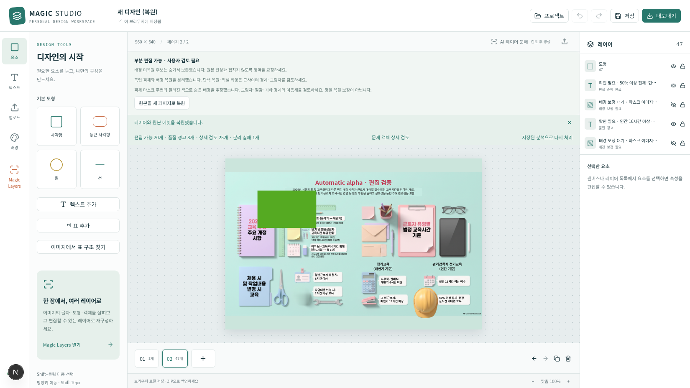
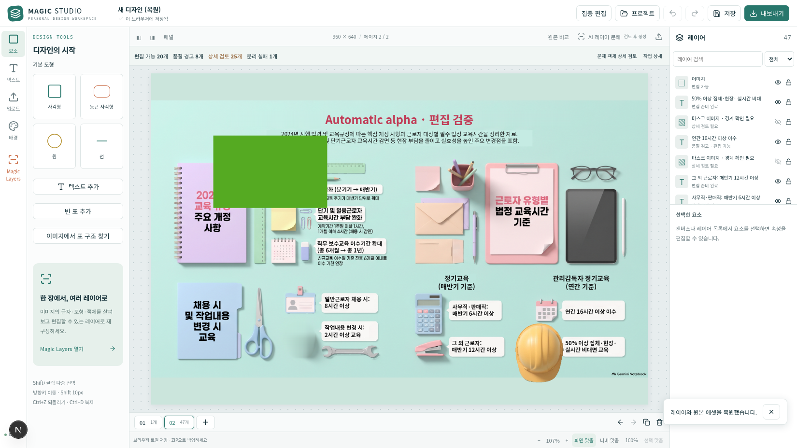

# 편집기 UI/UX 개선 — 부분 완료 · 2026-11-12 KST

**캔버스 확대와 조작·처리 UI는 검증했다. 텍스트/출력 일치와 전체 회귀는 완료하지 못했다.** 동일한 캔버스↔PNG 차이가 세 차례 연속 발생해 사용자의 중단 규칙에 따라 **8/12회에서 개발 반복을 종료**했다. 실패한 텍스트/글꼴 변경은 되돌렸다. **새 편집기 앱은 Preview에 배포하지 않았다.** 보존하는 앱 소스는 부분 기능 검증 커밋 `410d3c3dfe276ed35411c16a5613574752ca535a`와 정확히 같다.

## 설계 검토와 도구

- `frontend-design`, `systematic-debugging`, 실행 환경·Vercel 배포 및 PPTX 스킬을 참고했다. 실제 Chromium/Playwright로 측정했다.
- Figma MCP 도구는 사용 가능하지만 기존 파일/key가 없었다. 승인 없이 신규 파일을 만들지 않았다. 별도 UI/UX Design System MCP는 callable 도구 목록에서 확인되지 않았다.
- WCAG2.2의 포커스·키보드·상태/대화상자 의미, 접기/펼치기 정보 계층, 데스크톱32–36px·터치40–44px 조작 기준을 적용했다. 전체 접근성 인증을 수행했다는 뜻은 아니다.
- 기존 잉크/청록 팔레트와 Noto Sans KR를 유지했다. 여백4/8/12/16/24, 헤더56px, 단일 상태줄40px, 도구212px/속성264px 기본 너비. 장식·추가 애니메이션·UI 라이브러리 없음. [설계 검토](editor-DESIGN.md).

## 동일 프로젝트에서 실측한 결과

기준은 이전 실제 Gemini46후보/MobileSAM 검증 프로젝트 ZIP이다. 레이어47개(잠긴 배경·기존 QA 도형 포함)이며 스크린샷의 초록 사각형과 수정 문자열은 **이전 편집 검증에서 추가한 프로젝트 내용**이다. 전후 동일 파일·선택 전·화면 맞춤 조건을 유지했다. 더 보기 좋게 만들려고 원본/QA 객체를 삭제하지 않았다. 실제 원본2752×1536은960×640 문서 안에 비율을 유지해 놓였다.

| 항목 · 1650×928 | 개선 전 | 보존한 개선 후 |
|---|---:|---:|
| 헤더 높이 | 76px | 56px |
| 안내 합계 높이 | 224px | **40px** |
| 상단 전체 높이(캔버스 시작 Y) | 347px | **136px** |
| 편집 viewport | 1081×473px | **1118×718px** |
| 실제 디자인 이미지 | 613.5×342.4px | **1029×574.3px** |
| 실제 이미지 면적 | 1배 | **약2.81배** |
| 선택 지연 중앙값 | 110.5ms | **52.9ms** |
| 처리 중 닫기 | busy에서 비활성 | **134ms**, Worker종료·늦은 페이지 생성0 |

선택 지연은47레이어에서 포인터 누름→두 번째 animation frame까지8표본이다. 실제 현장 INP나 사용자가 보고한298.1ms와 같은 측정은 아니다. 이미지 캐시는 원래 존재했다. 레이어별 새 함수 때문에 무효화되던 기존 memo 경계를 안정화하고, 레이어 행을 메모화했다. [원자료](../../evidence/studio/editor-ui/results.json).

| viewport | 전 실제 이미지 | 후 실제 이미지 |
|---|---:|---:|
| 1920×1080 | 841.5×469.7 | 1257×701.6 |
| 1650×928 | 613.5×342.4 | 1029×574.3 |
| 1366×768 | 373.5×208.5 | 789×440.4 |
| 390×844 | 277.2×154.7 | 310×173.0 |

컨테이너만 커졌다고 판정하지 않았다. 프로젝트의 실제 이미지 fit과 문서 배율을 적용한 표시 크기다. 작은 화면은 가로 폭이 제한돼 확대 폭이 작으며 패널은 드로어로 작동한다. 네 viewport에서 문서 가로 overflow 없음.

## 반영한 동작

- 여러 안내를 하나의 상태줄로 통합. 상세 진단·원본 복원·재처리는 `작업 상세`, 문제 후보는 별도 검토 대화상자에 유지. 일반 안내는6초 toast, 오류/데이터 손실 위험은 자동 숨기지 않는다.
- 화면 맞춤·너비 맞춤·실제 문서100%·선택 맞춤·확대/축소. 상대 맞춤 배율을100%로 잘못 표시하던 문제를 분리. 수동 배율은 창 크기/집중 모드 변경에서도 유지.
- 집중 편집으로 양쪽 패널을 접고 다시 열거나 이전 구성으로 돌아갈 수 있다. 패널 너비는 키보드 사용 가능한 range로 조절. 선택과 원본 프로젝트는 보존.
- 레이어 검색/유형 필터, 선택 행 자동 식별, 상태별 표시, 경고 객체 편집 유지. C/실패를 교정 전에 켜서 원본과 중복 표시하는 동작은 방지.
- 원본 비교는 데이터 변경 없는 오버레이. 기존 원본 새 페이지 복원·undo·내보내기 메뉴를 유지한다.
- 자동 처리 닫기는 **취소하고 닫기**다. AbortController·실행 ID·마운트 상태로 늦은 적용을 차단한다. 완료 분석을 보존하며 재개 시 분석 요청1회 유지. 작업을 백그라운드에서 계속한다고 안내하지 않는다.
- 모델 읽기의 실제 byte/MiB, SHA검사, 실행 환경 초기화, 특징 분석, 객체 마스크, 배경 복원, 레이어 구성 단계를 구분. 두 모델의 검증된 buffer를CacheStorage에 재사용하고 재사용 시 해시 재검사. 최초 약57MB는 모델+런타임 안내이며 임의 진행률은 없다.

## 검증과 미완료 항목

- 단계1 감사 통과(회1), 단계2 레이아웃 통과(회3), 단계3 취소/진행 통과(회5). TypeScript·ESLint·단위122통과/외부corpus조건부1생략. 레이아웃 브라우저3통과; 처리 브라우저4통과(실제 encoder 취소/닫기와 중복 분석 방지 포함).
- 다운로드503·실행 환경 초기화503을 의도적으로 주입한 테스트는 원인별 안내→저장 분석 재사용→실제 모델 추론 성공을 검증했다. 목 분할 결과로 성공을 만들지 않았다.
- 새 Gemini 실호출0. 저장된 실제 응답을 재생했고 MobileSAM은 실제 실행했다. 모델 바이너리·신뢰도/마스크/이웃 보호 기준은 변경하지 않았다.
- **단계4 텍스트 미완료:** 19후보 상자 맞춤 실험은 통과했으나 캔버스/PNG 일치가6·7·8회 연속 실패. 바뀐 픽셀0.5186%, 채널 평균 차이0.6359, 잉크 하단1px 차이/첫 줄 끝4px 차이. 글꼴 로딩 통합 가설로도 동일했다. 원인을 해결했다고 주장하지 않으며 해당 변경은 반영하지 않았다. 원래 서식/글꼴의 정확 복원도 주장하지 않는다.
- **단계5 전체 회귀 미실행:** 이번 스냅샷에서 ZIP·PNG/PDF/PPTX 전체 흐름과 Office열기/최적화 빌드 브라우저를 재검증하지 못했다. 이전 작업의 통과 결과를 이번 결과로 재사용하지 않는다. 기존 경로 접근은 보존했으나 전체 호환성 통과로 보고하지 않는다.
- 실제 canvas 선택/드래그/zoom 및 JS heap 측정은 회8 실험에도 남겼으나 텍스트 변경을 되돌렸으므로 해당 메모리 수치를 보존 코드의 성능 인증으로 쓰지 않는다. 다른 브라우저 계열/실기기 모바일은 미검증.
- 자동 처리 요약은 재구성 당시 후보 진단을 사용한다. 삭제/숨김 이후 실시간 요약 갱신과 기존 프로젝트의 모든 상태 표시는 추가 검증이 필요하다.
- **단계6 BLOCK:** 독립 검토가 필수 전체 회귀/최적화 빌드 미완료를 이유로 앱 배포를 보류했다. 기존 Preview 앱 소스는 유지한다. 보고서·증거만 원격에 보존할 수 있으며, 자동 빌드가 생겨도 새 UI 배포로 보고하지 않는다. 호스팅 UI 검증은 미실행이며 실행 환경은 이전부터 Preview CONNECT403 제한이 있었다.

## 시각 증거

같은1650×928·동일 ZIP·화면 맞춤:

- [집중 편집](../../evidence/studio/editor-ui/after-focus.png)
- [진행 단계](../../evidence/studio/editor-ui/processing-stages.png)
- [닫기 후 분석 재개](../../evidence/studio/editor-ui/closed-analysis-resume.png)
- [레이어 선택·속성](../../evidence/studio/editor-ui/after-selection.png)
- [문제 객체 검토](../../evidence/studio/editor-ui/after-exceptions.png)
- [해결되지 않은 출력 비교](../../evidence/studio/editor-ui/known-issue/README.md)

## 체크포인트와 중단

`49d031b` 감사 → `b482f4c` 캔버스 UI → `410d3c3` 처리/취소. 회2는 숨긴 모바일 도구를 기다리던 테스트 준비 조건, 회4는 새 접근성 닫기 이름을 쓰지 않던 테스트 선택자를 수정했다. 회6·7·8은 동일 출력 차이로 중단. 실패 로그와 원인군을 보존하고 남은4회를 억지로 소비하지 않았다.

[editor-state.json](editor-state.json)의 halt를 지우거나 이전24/12회 기록을 초기화해 자동 재개하지 않는다. main·Production·키·SSO·모델 파일·사용자 프로젝트 데이터는 유지한다. 이번 종료는 전체 완료가 아닌 사용자 중단 규칙에 따른 부분 종료다.

## 독립 검토와 원격 보존

발행 직전 원격에 `1d7a456` AI팀 개발 절차 문서가 추가돼 push가 거절됐다. 강제 push 없이 문서만 병합했다. 새 AGENTS.md/[ai-dev-team 스킬](../../.agents/skills/ai-dev-team/SKILL.md)에 따라 실제 별도 reviewer를 실행했다. 이 절차는 구현 이후에 발견됐으므로 독립 기획/구현/QA가 처음부터 수행됐다고 주장하지 않는다.

독립 reviewer `/root/release_review`는 소스/기존 증거만 읽었으며 테스트·빌드·API를 실행하지 않았다. 결론은 **BLOCK**: 필수 릴리스 게이트 미실행, 확대된 전체 Stage 할당 상한 부재, 중심 회전 원/별의 선택 맞춤 좌표 불일치, 일부 초과 크기 모델 캐시의 반복 실패 경로다. 후자의 세 항목은 정적 검토 결과이며 충돌/메모리 초과를 실제 재현했다는 주장은 아니다. [원문 검토 기록](../../evidence/studio/editor-ui/release-review.md). 중단 규칙을 우회해 수정하지 않았다.

**Preview 앱 반영은 하지 않는다.** 체크포인트와 미배포 소스는 Git bundle/patch로 보존하며, 원격에는 보고서·증거만 게시한다. 기존 Preview URL을 새 UI 결과로 오인하지 않도록 배포 기록에 명시한다.

## 원격 자료와 코드 복구

이 보고서가 있는 Preview 브랜치에는 **문서·증거만 추가**했다. `apps/studio/src`, public모델, package는 원격 기존 앱과 동일하다. 새 편집기 UI를 반영한 배포가 아니다.

- [미배포 코드 Git bundle](../../evidence/studio/editor-ui/editor-checkpoints.bundle): 기존 저장소에서 `git bundle verify <file>` 후 별도 로컬 검토 참조로 fetch할 수 있다. 사용자 중단 규칙을 해제하거나 자동 배포하지 않는다.
- [앱 소스 패치](../../evidence/studio/editor-ui/editor-ui-prototype.patch): bf1962d→410d3c3 미배포 시안.
- [Preview/보존 기록](../../evidence/studio/editor-ui/preview.json). 기존 검증 URL은 새 UI가 아니다.
- 테스트/루프 실행 스크립트는 bundle의 보존 코드에 있다. 원격 보고서만으로 누락된 테스트를 통과했다고 간주하지 않는다.
